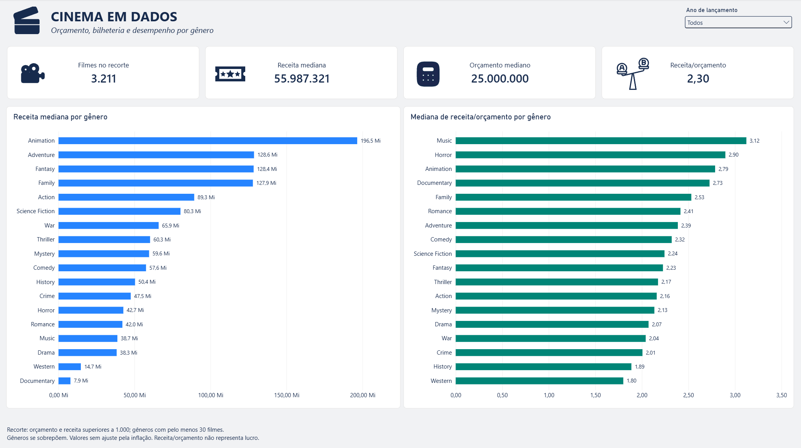
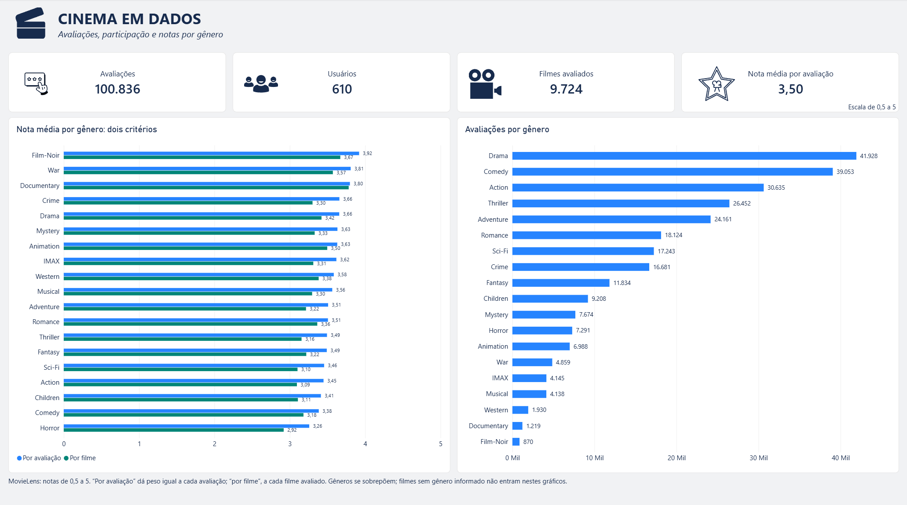
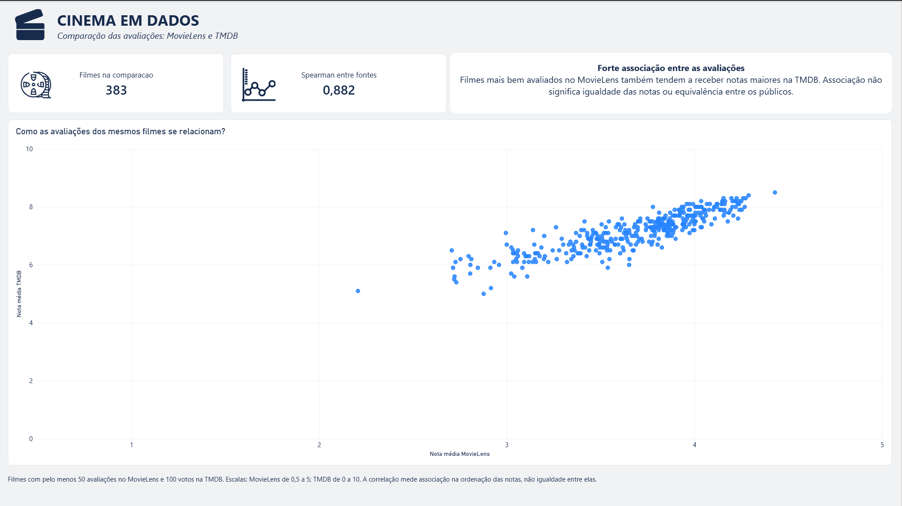

# Cinema em Dados

**Análise de orçamento, bilheteria e avaliações de filmes com Python, SQL e Power BI.**

[English version](README_EN.md)

O projeto investiga como orçamento e gênero se relacionam com a receita dos filmes, como a ponderação altera as notas por gênero e até que ponto as avaliações de MovieLens e TMDB apresentam ordenações semelhantes.

O trabalho percorre diagnóstico, tratamento, integração por identificadores, análise exploratória, validações em SQL e apresentação em um relatório de três páginas no Power BI.

## Principais resultados

| Análise | Resultado | Recorte |
|---|---|---|
| Orçamento × receita | Spearman de **0,675** | 3.211 filmes com orçamento e receita superiores a 1.000 |
| Indicadores financeiros | Orçamento mediano de **25.000.000**, receita mediana de **55.987.321** e múltiplo mediano de **2,30** | Mesmo recorte financeiro |
| Receita por gênero | Animation: receita mediana de **196,5 milhões** | 186 filmes; gêneros com pelo menos 30 filmes no gráfico |
| Receita/orçamento por gênero | Music: **3,12**; Horror: **2,90** | Mediana dos múltiplos individuais |
| Orçamento × nota TMDB | Spearman de **−0,184** | 2.708 filmes do recorte financeiro com pelo menos 100 votos |
| Participação no MovieLens | **100.836 avaliações**, **610 usuários**, **9.724 filmes avaliados** | Cadastro de 9.742 filmes |
| Notas entre fontes | Spearman de **0,882** | 383 filmes; mínimo de 50 avaliações MovieLens e 100 votos TMDB |

Os resultados descrevem os recortes analisados. Associação não estabelece causalidade, e receita/orçamento **não representa lucro**.

## Relatório Power BI

### 1. Desempenho financeiro

Indicadores de mediana, seleção de ano e comparação dos gêneros por receita e múltiplo receita/orçamento. A seleção de gênero atualiza os cartões.



### 2. Avaliações do público

Volume de avaliações e comparação entre duas médias: peso igual para cada avaliação ou peso igual para cada filme avaliado. A seleção de gênero atualiza avaliações, usuários, filmes e nota.



### 3. Comparação entre fontes

Dispersão das notas dos mesmos filmes e correlação de Spearman, calculada também em DAX com postos médios para empates. Clicar em um ponto não filtra os dois cartões, que representam o conjunto comparado.



## Fontes e escopo

- [TMDB 5000 Movie Dataset — Kaggle](https://www.kaggle.com/datasets/tmdb/tmdb-movie-metadata): `tmdb_5000_movies.csv`, com 4.803 filmes.
- [MovieLens latest-small — GroupLens](https://grouplens.org/datasets/movielens/latest/): `movies.csv`, `ratings.csv` e `links.csv`. O recorte utilizado tem 9.742 filmes, 100.836 avaliações e 610 usuários.
- [Documentação e condições de uso do MovieLens](https://files.grouplens.org/datasets/movielens/ml-latest-small-README.html).

As bases são fotografias históricas, não consultas em tempo real. `movieId` do MovieLens e `id` da TMDB pertencem a sistemas diferentes; a integração utiliza `links.csv`.

## Metodologia e qualidade dos dados

1. Diagnóstico de tipos, ausências, zeros, listas vazias, duplicidades e integridade referencial.
2. Preservação das bases originais em DataFrames separados dos tratados.
3. Conversão das datas de lançamento e dos timestamps de avaliação; nenhuma falha adicional de conversão na execução registrada.
4. Criação de colunas analíticas: orçamento, receita e duração não positivos ficam ausentes; notas TMDB sem votos ficam ausentes. Trata-se de uma convenção analítica, não de uma correção comprovada da fonte.
5. Leitura do JSON de gêneros TMDB e separação dos gêneros MovieLens por `|`, com tabelas de relações filme–gênero.
6. Recorte financeiro estritamente acima de 1.000 em orçamento **e** receita: 3.211 filmes, 66,85% da TMDB. Cenários com limites 0, 100, 1.000 e 10.000 apresentaram múltiplo mediano de 2,30 no arredondamento mostrado.
7. Integração por IDs e isolamento das correspondências ambíguas. Os `movieId` 6003 e 144606 apontam para `tmdbId` 4912; ambos são excluídos apenas da integração única, sem remover suas avaliações da análise original MovieLens.
8. Auditoria de 66 divergências de ano: 64 de um ano e duas de dois anos. As datas originais são preservadas.
9. Comparação das notas com mínimos de participação e análise de sensibilidade: Spearman entre 0,853 e 0,913 para mínimos MovieLens de 10, 25, 50 e 100, mantendo 100 votos TMDB.
10. Exportação de CSVs, consultas e SQLite, com conferência de contagens, igualdade do ranking SQL/Pandas e reabertura do banco salvo.

### Tabelas exportadas

| Tabela | Granularidade | Linhas |
|---|---|---:|
| `filmes_tmdb` | Filme TMDB | 4.803 |
| `filmes_movielens` | Filme MovieLens | 9.742 |
| `avaliacoes` | Avaliação de um usuário para um filme | 100.836 |
| `generos_tmdb` | Relação filme–gênero | 12.160 |
| `generos_movielens` | Relação filme–gênero | 22.050 |
| `correspondencias` | Par de IDs sem ambiguidade de cardinalidade | 3.535 |

Há 18 filmes MovieLens sem avaliações: quantidade zero e nota ausente. Os gráficos por gênero excluem filmes sem gênero informado. Por isso, cobrem 100.789 avaliações MovieLens; no recorte financeiro, 3.210 dos 3.211 filmes têm gênero. Totais por gênero não devem ser somados, pois as categorias se sobrepõem.

## Tecnologias

Python, Pandas, Matplotlib, SciPy, Jupyter, SQLite, SQL, Power Query, Power BI e DAX. O `requirements.txt` registra o ambiente completo exportado, incluindo dependências transitivas e componentes do Jupyter.

## Estrutura

| Caminho | Conteúdo |
|---|---|
| `notebooks/01_diagnostico_dados.ipynb` | Diagnóstico, tratamento, gráficos, conclusões, SQL e exportações |
| `dados/` | Quatro CSVs de entrada obtidos nas fontes |
| `dados/processados/` | Seis CSVs de tabelas, `cinema.sqlite` e dois CSVs de auditoria |
| `sql/01_ranking_filmes.sql` | Ranking com pelo menos 50 avaliações |
| `sql/02_comparacao_fontes.sql` | Comparação das notas por correspondência de IDs |
| `sql/03_avaliacoes_por_genero.sql` | Médias e participação por gênero |
| `powerbi/Projeto_C_Analise_Cinema.pbix` | Relatório Power BI |
| `imagens/` | Capturas das três páginas |
| `requirements.txt` | Dependências com versões |

## Como reproduzir

### Python e SQL

1. Baixe os dados nas fontes e coloque `tmdb_5000_movies.csv`, `movies.csv`, `ratings.csv` e `links.csv` em `dados/`. Use os arquivos MovieLens da mesma distribuição; confira as contagens acima.
2. Na raiz do projeto, crie o ambiente e instale as dependências:

```powershell
py -m venv .venv
.\.venv\Scripts\python.exe -m pip install -r requirements.txt
```

O notebook enviado registra Python 3.11.0 nos metadados. O arquivo de dependências foi exportado em Windows e inclui `pywinpty`; outros sistemas podem exigir adaptação das dependências de plataforma. A instalação em um ambiente limpo adicional não foi verificada neste projeto.

3. Abra o notebook no VS Code, com as extensões Python e Jupyter, e selecione `.venv\Scripts\python.exe` como kernel. Execute a partir da raiz do projeto ou da pasta `notebooks`, pois o código procura `dados` nesses dois níveis.
4. Reinicie o kernel e execute todas as células em ordem. O notebook gera ou substitui os arquivos derivados em `dados/processados/` e as três consultas em `sql/`.
5. Abra `dados/processados/cinema.sqlite` em um cliente SQLite ou use `sqlite3` no Python para executar as consultas.

### Power BI

1. Abra `powerbi/Projeto_C_Analise_Cinema.pbix` no Power BI Desktop.
2. No Power Query, ajuste os caminhos das seis consultas CSV para sua pasta `dados/processados/`; os caminhos locais do autor não são portáveis.
3. Os CSVs usam UTF-8 com BOM, vírgula como delimitador e **ponto decimal**. Converta os números a partir do texto com localidade **Inglês (Estados Unidos)**. Uma conversão anterior com localidade incorreta pode remover o ponto e multiplicar os valores por dez; apenas mudar a localidade depois não recupera os dados.
4. Atualize e confira: 3.211 filmes financeiros, orçamento mediano 25.000.000, receita mediana 55.987.321; 100.836 avaliações; 383 filmes comparados e Spearman 0,882.

O Power BI lê os CSVs; o SQLite é uma saída adicional para consultas e validação. A tabela DAX de comparação é independente dos relacionamentos das outras páginas e usa um recorte fixo definido na atualização do modelo.

## Limitações e interpretação

- Valores financeiros são nominais, sem ajuste pela inflação ou conversão cambial realizada no projeto. O limite de 1.000 é exploratório e pode excluir receitas pequenas legítimas.
- Bilheteria não equivale à receita líquida do estúdio; marketing, distribuição e outros custos não estão integralmente disponíveis. O múltiplo não mede lucro ou ROI.
- Dados financeiros ausentes e mínimos de votos alteram a composição dos recortes; resultados não representam toda a indústria.
- MovieLens e TMDB têm públicos, escalas e períodos diferentes. Spearman mede associação de postos, não igualdade das notas.
- As classificações de gênero das fontes são mantidas separadas; `Music` e `Musical`, por exemplo, não são harmonizados automaticamente.
- Ausência de IDs duplicados não garante que todas as correspondências da fonte estejam semanticamente corretas. Divergências foram sinalizadas, não corrigidas por suposição.

## Créditos

Projeto desenvolvido por **Guilherme Milani** para portfólio de análise de dados.

Dados: TMDB/Kaggle e GroupLens/MovieLens. A disponibilização do projeto não altera os termos dos conjuntos de dados. Consulte as condições das fontes antes de redistribuir dados ou reutilizá-los comercialmente.

Referência MovieLens: F. Maxwell Harper e Joseph A. Konstan. 2015. *The MovieLens Datasets: History and Context*. ACM Transactions on Interactive Intelligent Systems, 5(4), artigo 19. https://doi.org/10.1145/2827872
