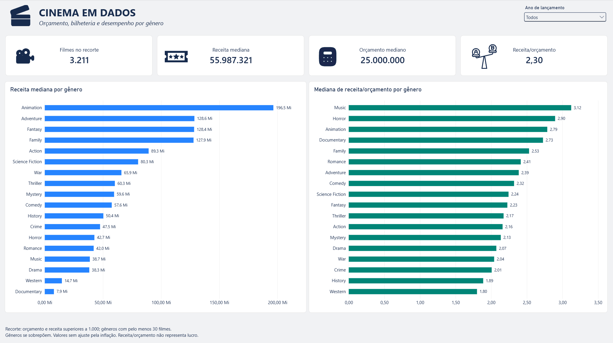
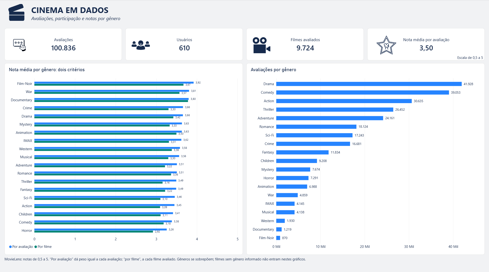
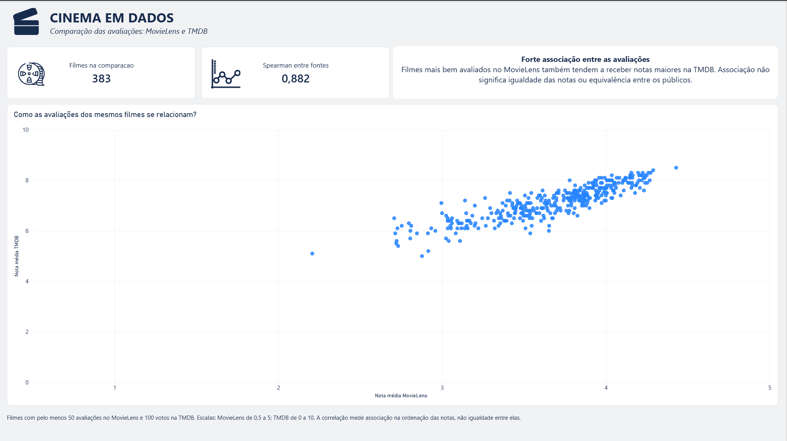

# Cinema em Dados — Cinema in Data

**Movie budget, box office and audience ratings analysis with Python, SQL and Power BI.**

[Versão em português](README.md)

This project examines how budgets and genres relate to revenue, how weighting changes genre ratings, and whether MovieLens and TMDB ratings rank the same movies similarly. It covers data profiling, cleaning, identifier-based integration, exploratory analysis, SQL validation and a three-page Power BI report.

## Key findings

| Analysis | Result | Scope |
|---|---|---|
| Budget vs. revenue | Spearman **0.675** | 3,211 movies with both budget and revenue strictly above 1,000 |
| Financial metrics | Median budget **25,000,000**, median revenue **55,987,321**, median revenue/budget multiple **2.30** | Same financial subset |
| Revenue by genre | Animation: median revenue **196.5 million** | 186 movies; charts require at least 30 movies per genre |
| Revenue/budget by genre | Music: **3.12**; Horror: **2.90** | Median of individual movie multiples |
| Budget vs. TMDB rating | Spearman **−0.184** | 2,708 financial-subset movies with at least 100 votes |
| MovieLens participation | **100,836 ratings**, **610 users**, **9,724 rated movies** | Catalog of 9,742 movies |
| Cross-source ratings | Spearman **0.882** | 383 movies with at least 50 MovieLens ratings and 100 TMDB votes |

Findings describe the selected data. Association does not establish causation, and revenue/budget **is not profit**.

## Power BI report

### 1. Financial performance

Median metrics, release-year selection, and genre comparisons by revenue and revenue/budget multiple. Genre selections update the cards.



### 2. Audience ratings

Rating volume and two weighting methods: equal weight per rating versus equal weight per rated movie. Genre selections update rating counts, distinct users, rated movies and average rating.



### 3. Cross-source comparison

A scatter plot of the same movies' ratings and Spearman correlation, also implemented in DAX using average ranks for ties. Point selections do not filter the two cards, which describe the comparison set.



## Data sources

- [TMDB 5000 Movie Dataset — Kaggle](https://www.kaggle.com/datasets/tmdb/tmdb-movie-metadata): `tmdb_5000_movies.csv`, containing 4,803 movies.
- [MovieLens latest-small — GroupLens](https://grouplens.org/datasets/movielens/latest/): `movies.csv`, `ratings.csv` and `links.csv`. The distribution used contains 9,742 movies, 100,836 ratings and 610 users.
- [MovieLens documentation and usage conditions](https://files.grouplens.org/datasets/movielens/ml-latest-small-README.html).

These are historical snapshots, not live data. MovieLens `movieId` and TMDB `id` are different identifier systems; integration uses `links.csv`.

## Key Findings and Interpretation

### Higher revenue does not necessarily mean a higher revenue-to-budget ratio

Among genres with at least 30 films in the financial subset, **Animation** has the highest median revenue, approximately **196.5 million**. **Music**, however, leads in median revenue-to-budget ratio at **3.12**, followed by **Horror** at **2.90**.

These metrics answer different questions: revenue measures absolute box office earnings, while the ratio relates revenue to the reported production budget. This ratio **does not represent profit**, as it excludes costs such as marketing, distribution, and theaters' share of ticket sales.

### Rating volume and average scores reveal different aspects of audience activity

**Drama** receives the largest number of MovieLens ratings, with **41,928 records**. **Film-Noir**, on the other hand, has the highest average score per rating, approximately **3.92 out of 5**, based on **870 ratings**.

The most frequently rated genre is not necessarily the highest-rated one. Differences in sample size also require caution: these averages reflect the users and films included in the dataset, rather than a universal audience preference.

### MovieLens and TMDB show a strong association in how films are ranked

For **383 matched films**, each with at least **50 MovieLens ratings** and **100 TMDB votes**, the Spearman correlation is **0.882**.

This indicates that films with higher MovieLens scores also tend to receive higher TMDB scores. The association concerns the **ordering of scores**; it does not imply identical ratings, equivalent audiences, or a causal relationship.

### Interpretation Limits

The findings depend on the selected subsets and inclusion criteria. Genres overlap, so their counts should not be added together as mutually exclusive categories. Financial figures have not been adjusted for inflation, and the conclusions describe the analyzed sample.

## Methodology and data quality

1. Profile data types, missing values, zeros, empty lists, duplicates and referential integrity.
2. Preserve original DataFrames separately from cleaned copies.
3. Convert release dates and rating timestamps; the recorded execution reports no additional conversion failures.
4. Create analytical columns: nonpositive budgets, revenues and runtimes become missing; TMDB ratings without votes become missing. These are analytical conventions, not verified corrections to the source.
5. Parse TMDB genre JSON and MovieLens pipe-separated genres into movie–genre relationship tables.
6. Select movies with budget **and** revenue strictly above 1,000: 3,211 movies, 66.85% of TMDB. Threshold scenarios of 0, 100, 1,000 and 10,000 retain a median multiple of 2.30 at the displayed precision.
7. Integrate by IDs and isolate ambiguous mappings. MovieLens IDs 6003 and 144606 map to TMDB ID 4912; both are excluded only from the unique integration, while their ratings remain in the original MovieLens analysis.
8. Flag 66 release-year discrepancies: 64 of one year and two of two years. Preserve original dates.
9. Compare ratings with participation thresholds. Sensitivity analysis yields Spearman values from 0.853 to 0.913 for minimum MovieLens counts of 10, 25, 50 and 100, keeping the TMDB minimum at 100 votes.
10. Export CSVs, SQL queries and SQLite; check row counts, SQL/Pandas ranking equality and the reopened database.

### Exported tables

| Table | Grain | Rows |
|---|---|---:|
| `filmes_tmdb` | TMDB movie | 4,803 |
| `filmes_movielens` | MovieLens movie | 9,742 |
| `avaliacoes` | One user's rating of a movie | 100,836 |
| `generos_tmdb` | Movie–genre relationship | 12,160 |
| `generos_movielens` | Movie–genre relationship | 22,050 |
| `correspondencias` | ID pair without cardinality ambiguity | 3,535 |

There are 18 MovieLens movies without ratings: their count is zero and their rating is missing. Genre charts exclude movies without genre information, covering 100,789 MovieLens ratings. In the financial subset, 3,210 of 3,211 movies have a genre. Genre counts must not be added together because categories overlap.

## Technology

Python, Pandas, Matplotlib, SciPy, Jupyter, SQLite, SQL, Power Query, Power BI and DAX. `requirements.txt` captures the full exported environment, including transitive dependencies and Jupyter components.

## Project layout

| Path | Contents |
|---|---|
| `notebooks/01_diagnostico_dados.ipynb` | Profiling, cleaning, plots, conclusions, SQL and exports |
| `dados/` | Four input CSV files obtained from the sources |
| `dados/processados/` | Six table CSVs, `cinema.sqlite` and two audit CSVs |
| `sql/01_ranking_filmes.sql` | Ranking with at least 50 ratings |
| `sql/02_comparacao_fontes.sql` | Cross-source rating comparison through ID mappings |
| `sql/03_avaliacoes_por_genero.sql` | Genre rating averages and participation |
| `powerbi/Projeto_C_Analise_Cinema.pbix` | Power BI report |
| `imagens/` | Screenshots of all three pages |
| `requirements.txt` | Pinned dependencies |

## Reproduction

### Python and SQL

1. Obtain the source data and place `tmdb_5000_movies.csv`, `movies.csv`, `ratings.csv` and `links.csv` in `dados/`. Use MovieLens files from the same distribution and check the counts above.
2. From the project root, create the environment and install dependencies:

```powershell
py -m venv .venv
.\.venv\Scripts\python.exe -m pip install -r requirements.txt
```

The submitted notebook records Python 3.11.0 in its metadata. The dependency file was exported on Windows and includes `pywinpty`; other operating systems may require platform-specific adjustments. Installation in an additional clean environment was not verified in this project.

3. Open the notebook in VS Code with the Python and Jupyter extensions and select `.venv\Scripts\python.exe` as the kernel. Run from the project root or `notebooks`, since the notebook searches for `dados` at those two levels.
4. Restart the kernel and run all cells in order. Execution generates or replaces derived files in `dados/processados/` and the three queries in `sql/`.
5. Open `dados/processados/cinema.sqlite` in a SQLite client, or use Python's `sqlite3` module to run the queries.

### Power BI

1. Open `powerbi/Projeto_C_Analise_Cinema.pbix` in Power BI Desktop.
2. Update the six CSV source paths in Power Query to your own `dados/processados/` folder. The author's local absolute paths are not portable.
3. CSVs use UTF-8 with BOM, comma delimiters and **decimal points**. Convert numeric columns from text using the **English (United States)** locale. An earlier conversion with the wrong locale may remove decimal points and multiply values by ten; changing locale afterward does not recover those values.
4. Refresh and check: 3,211 financial movies; median budget 25,000,000; median revenue 55,987,321; 100,836 ratings; 383 compared movies; Spearman 0.882.

Power BI reads the CSVs; SQLite is an additional output for querying and validation. The DAX comparison table is disconnected from the other pages' relationships and uses a fixed subset defined at model refresh.

## Limitations

- Financial values are nominal; no inflation adjustment or currency conversion was performed. The exploratory 1,000 threshold can exclude legitimate low revenues.
- Box office is not studio net revenue. Marketing, distribution and other costs are not fully available, so the multiple does not measure profit or ROI.
- Missing financial data and vote thresholds change subset composition; results do not represent the entire film industry.
- MovieLens and TMDB differ in users, rating scales and collection periods. Spearman measures rank association, not rating equality.
- Source genre classifications remain separate; categories such as `Music` and `Musical` are not automatically harmonized.
- Unique identifiers do not prove that every source mapping is semantically correct. Discrepancies are flagged rather than corrected by assumption.

## Credits

Developed by **Guilherme Milani** as a data analysis portfolio project.

Data: TMDB/Kaggle and GroupLens/MovieLens. Publishing this project does not change the datasets' terms. Review the source conditions before redistributing data or using it commercially.

MovieLens reference: F. Maxwell Harper and Joseph A. Konstan. 2015. *The MovieLens Datasets: History and Context*. ACM Transactions on Interactive Intelligent Systems, 5(4), article 19. https://doi.org/10.1145/2827872
